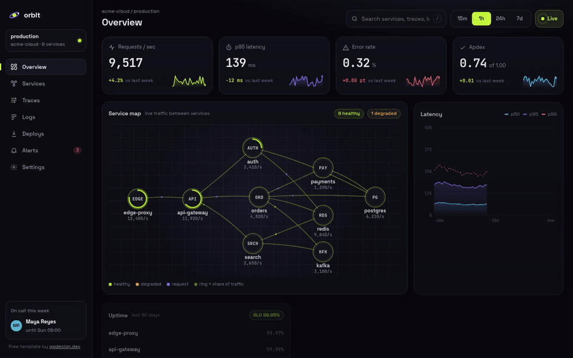
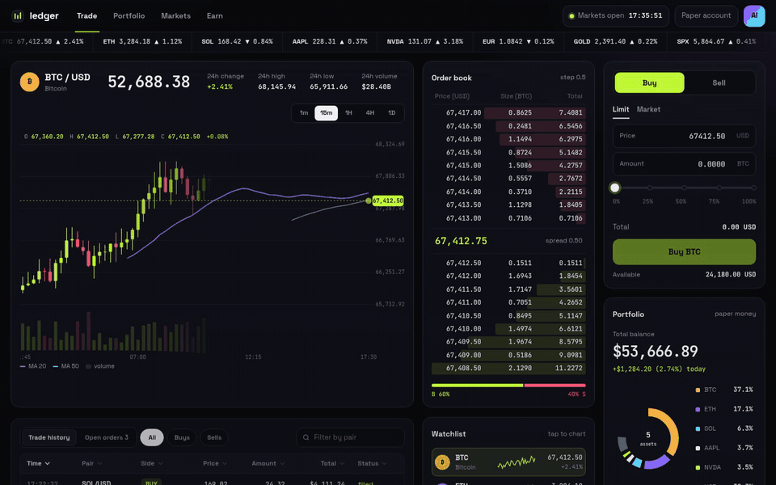
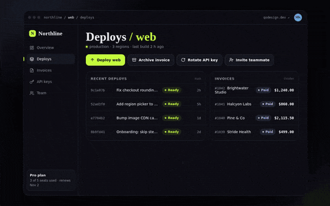
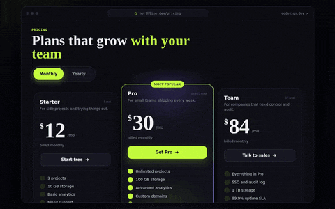
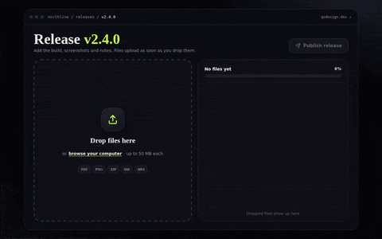
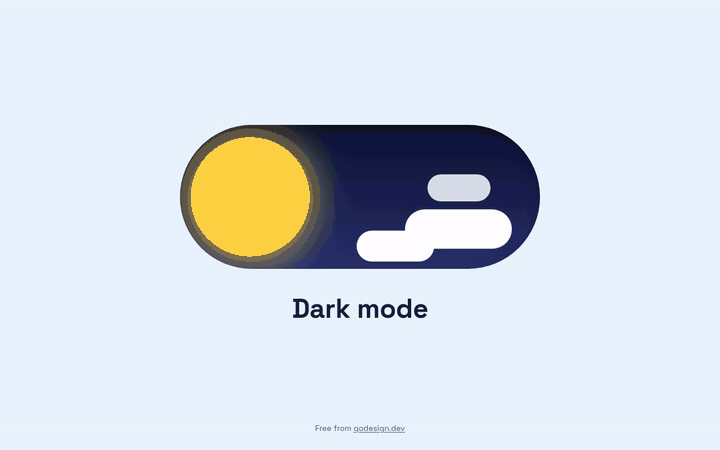

# qodesign-free

[](https://www.npmjs.com/package/qodesign-free) [](LICENSE)

[](https://teodoravadani.github.io/qodesign-free/orbit/)

Animated React + Tailwind components for AI-first builders who ship with Cursor, Lovable, v0 or Claude Code. Every folder has a `PROMPT.md`, so your agent can install a piece, wire it to your data and restyle it.

Four components and two full dashboards, written in TypeScript with Tailwind CSS and Framer Motion. They install with the shadcn CLI and work in Next.js, Vite and Lovable apps. MIT licensed.

**[Live demos](https://teodoravadani.github.io/qodesign-free/)** · **[qodesign.dev](https://qodesign.dev/?utm_source=github&utm_medium=readme&utm_campaign=free_repo)**

The shadcn CLI needs a `components.json` in your project. In a fresh Next.js app, run this once first:

```bash
npx shadcn@latest init
```

Then add any piece:

```bash
npx shadcn@latest add https://teodoravadani.github.io/qodesign-free/r/toast-stack.json
```

That copies the source into `components/<name>/` and installs `framer-motion` 11.18.2, the version we test with. The code is yours to edit from there.

This route needs Tailwind CSS in your project for the Day / Night Toggle, because its source uses Tailwind classes. The other five bring their own CSS file and work without Tailwind. The npm route below needs no Tailwind at all.

The registry index is at [`r/registry.json`](https://teodoravadani.github.io/qodesign-free/r/registry.json) and every item lives at `https://teodoravadani.github.io/qodesign-free/r/<name>.json`.

## Or install from npm

```bash
npm i qodesign-free framer-motion@11.18.2
```

Import each component from its own path. You only ship the CSS for what you use (about 10 KB of CSS for the toast stack and the toggle, against about 90 KB from the package root, which pulls in both dashboards):

```tsx
import { Toaster, toast } from 'qodesign-free/toast-stack';
import { DayNightToggle } from 'qodesign-free/day-night-toggle';
// also: 'qodesign-free/pricing-switch', 'qodesign-free/upload-dropzone',
//       'qodesign-free/orbit-dashboard', 'qodesign-free/ledger-dashboard'
```

`import { ... } from 'qodesign-free'` still works if you want everything in one line.

Each component brings its own stylesheet and starts with `'use client'`, so you can drop it into a Next.js server page. No Tailwind needed, the Day / Night Toggle included (since 0.1.1 it ships its own compiled CSS, scoped to the component). The shadcn route above is better when you want to edit the source.

| | |
|---|---|
| [](dashboards/orbit-observability) <br> **[Orbit](dashboards/orbit-observability)**: infrastructure observability dashboard. [Demo](https://teodoravadani.github.io/qodesign-free/orbit/) | [](dashboards/ledger-trading) <br> **[Ledger](dashboards/ledger-trading)**: trading desk dashboard. [Demo](https://teodoravadani.github.io/qodesign-free/ledger/) |
| [](components/toast-stack) <br> **[Toast Stack](components/toast-stack)**: notifications that stack like a deck and fan out. [Demo](https://teodoravadani.github.io/qodesign-free/toast-stack/) | [](components/pricing-switch) <br> **[Pricing Switch](components/pricing-switch)**: monthly / yearly switch with odometer prices. [Demo](https://teodoravadani.github.io/qodesign-free/pricing-switch/) |
| [](components/upload-dropzone) <br> **[Upload Dropzone](components/upload-dropzone)**: drag and drop with progress rings. [Demo](https://teodoravadani.github.io/qodesign-free/upload-dropzone/) | [](components/day-night-toggle) <br> **[Day / Night Toggle](components/day-night-toggle)**: the sun rolls into a moon. [Demo](https://teodoravadani.github.io/qodesign-free/day-night-toggle/) |

## Install

| Item | shadcn CLI | Single HTML file |
|---|---|---|
| Orbit dashboard | `npx shadcn@latest add https://teodoravadani.github.io/qodesign-free/r/orbit-dashboard.json` | [orbit.html](dashboards/orbit-observability/html/orbit.html) |
| Ledger dashboard | `npx shadcn@latest add https://teodoravadani.github.io/qodesign-free/r/ledger-dashboard.json` | [ledger.html](dashboards/ledger-trading/html/ledger.html) |
| Toast Stack | `npx shadcn@latest add https://teodoravadani.github.io/qodesign-free/r/toast-stack.json` | [toast-stack.html](components/toast-stack/html/toast-stack.html) |
| Pricing Switch | `npx shadcn@latest add https://teodoravadani.github.io/qodesign-free/r/pricing-switch.json` | [pricing-switch.html](components/pricing-switch/html/pricing-switch.html) |
| Upload Dropzone | `npx shadcn@latest add https://teodoravadani.github.io/qodesign-free/r/upload-dropzone.json` | [upload-dropzone.html](components/upload-dropzone/html/upload-dropzone.html) |
| Day / Night Toggle | `npx shadcn@latest add https://teodoravadani.github.io/qodesign-free/r/day-night-toggle.json` | [day-night-toggle.html](components/day-night-toggle/html/day-night-toggle.html) |

No shadcn setup? Copy the folder under `react/src/components/` into your project and run `npm i framer-motion@11.18.2`.

**Next.js App Router:** every component file already starts with `'use client'`, so it works in a server page as is.

**With an AI agent:** every folder has a `PROMPT.md` with prompts for Cursor, Claude Code, v0 or Lovable: add it to my project, wire it to my data, restyle it, port it to Vue or Svelte.

**No React?** Every item also comes as one HTML file (CSS and JS inline), linked in the table above.

## Using with Cursor

The repo ships two Cursor rules files: `.cursor/rules/qodesign.mdc` (installing and using these components in Next.js) and `.cursor/rules/qodesign-motion.mdc` (motion rules for any animated component: one rAF loop that pauses off-screen, reduced motion, transform/opacity only, passive listeners, no scroll traps, StrictMode-safe cleanup). Other agents can read `AGENTS.md`.

## What you get in each folder

```
<item>/
  react/               the component, plus a Vite + React + TS + Tailwind + Framer Motion demo app
  html/<item>.html     the same thing as one HTML file
  README.md            usage, props, accessibility
  PROMPT.md            prompts for AI coding agents
  preview.gif          the loop you see above
  proof/               screenshots at 1280 / 1440 px and 390 px
```

Run any React demo:

```bash
cd dashboards/orbit-observability/react   # or any other item
npm install
npm run dev
```

## Notes

- Every demo plays by itself until you touch it. Add `?demo=0` to turn that off.
- Everything respects Reduce Motion and has visible focus states and 44 px touch targets on phones.
- The page keeps scrolling when your cursor or finger is over a component.
- Data in the dashboards is simulated. Each README says which file to swap for your API.

## Paid, from the same author: 16 more on qodesign.dev

Everything above is free and MIT. This section is not: these pieces are paid and are not in this repo. They are sold on [qodesign.dev](https://qodesign.dev/?utm_source=github&utm_medium=readme&utm_campaign=free_repo), $3 each (the analytics dashboard is $9). Each one ships the same way: a React + TypeScript + Tailwind component, a PROMPT.md and an HTML version.

- [Particle Morph](https://qodesign.dev/components/particle-morph?utm_source=github&utm_medium=readme&utm_campaign=free_repo): 9,000 particles that spring between a sphere, a word and a torus knot.
- [Pull-Cord Login](https://qodesign.dev/components/pull-cord-login?utm_source=github&utm_medium=readme&utm_campaign=free_repo): pull the cord, the lamp turns on, the login form appears.
- [Credit Card Checkout V1](https://qodesign.dev/components/credit-card-checkout-v1?utm_source=github&utm_medium=readme&utm_campaign=free_repo): a live 3D card that fills in as you type and flips for the CVC.
- [Shy Eyes Login](https://qodesign.dev/components/shy-eyes-login?utm_source=github&utm_medium=readme&utm_campaign=free_repo): a mascot that watches you type and covers his eyes for the password.
- [Hold to Delete](https://qodesign.dev/components/hold-to-delete?utm_source=github&utm_medium=readme&utm_campaign=free_repo): press and hold, then the file crumples into the bin.
- [Dynamic Island Navbar](https://qodesign.dev/components/dynamic-island?utm_source=github&utm_medium=readme&utm_campaign=free_repo): a pill navbar that morphs for notifications, music and search.
- [Liquid Metal Blob](https://qodesign.dev/components/liquid-metal?utm_source=github&utm_medium=readme&utm_campaign=free_repo): a drop of liquid chrome drawn live by a WebGL shader.
- [Step-Up OTP Gate](https://qodesign.dev/components/otp-verify?utm_source=github&utm_medium=readme&utm_campaign=free_repo): arcs merge into one check and the blurred dashboard behind unlocks.
- [Command-K Dashboard](https://qodesign.dev/components/dashboard-saas?utm_source=github&utm_medium=readme&utm_campaign=free_repo): a whole SaaS app you drive from ⌘K.
- [Receipt Morph Checkout](https://qodesign.dev/components/checkout-card?utm_source=github&utm_medium=readme&utm_campaign=free_repo): your card splits, unrolls into a receipt and gets stamped PAID.
- [Liquid Glass Tab Bar](https://qodesign.dev/components/tabbar-liquid?utm_source=github&utm_medium=readme&utm_campaign=free_repo): a glass drop that magnifies the tab under it.
- [Spotlight Lamp Login](https://qodesign.dev/components/lamp-login?utm_source=github&utm_medium=readme&utm_campaign=free_repo): a desk lamp finds each field in the dark.
- [Stack Cart Drawer](https://qodesign.dev/components/cart-drawer?utm_source=github&utm_medium=readme&utm_campaign=free_repo): products fly into the cart and unfold into line items.
- [Prompt Bloom](https://qodesign.dev/components/prompt-bloom?utm_source=github&utm_medium=readme&utm_campaign=free_repo): an AI chat composer where the prompt lifts into a message and the answer card blooms out of the input.
- [Reflow Sidebar](https://qodesign.dev/components/reflow-sidebar?utm_source=github&utm_medium=readme&utm_campaign=free_repo): collapse the sidebar to an icon rail and the whole app reflows with it on a spring.
- [Analytics Dashboard V1](https://qodesign.dev/components/analytics-dashboard-v1?utm_source=github&utm_medium=readme&utm_campaign=free_repo): a dark analytics dashboard where every number counts up live ($9).

**[All 16 for $29 in one payment](https://qodesign.dev/all-access?utm_source=github&utm_medium=readme&utm_campaign=free_repo)**. Pro Lifetime also includes every piece released later: [see pricing](https://qodesign.dev/pricing?utm_source=github&utm_medium=readme&utm_campaign=free_repo).

## Contributing

PRs welcome: bug fixes, new examples, a11y improvements. Open an issue first for big changes. [CONTRIBUTING.md](CONTRIBUTING.md) has the details.

## Licence

[MIT](LICENSE). Use anything here in personal and commercial projects. Credit is welcome, not required.

Made by [Teodor](https://github.com/teodoravadani) at [qodesign.dev](https://qodesign.dev/?utm_source=github&utm_medium=readme&utm_campaign=free_repo).
